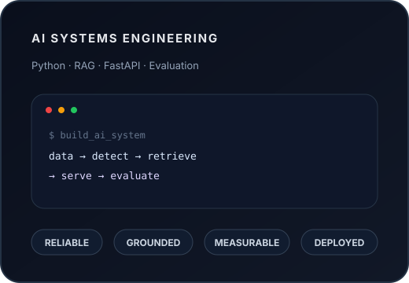

# Sravani Kamjula

### AI/ML Engineer | Generative AI | Python | RAG | FastAPI

[Portfolio](https://sravaniportfoli.netlify.app/) ·
[LinkedIn](https://www.linkedin.com/in/sravani-kamjula/) ·
[Email](mailto:sravanikamjula@gmail.com) ·
[Kaggle](https://www.kaggle.com/sravanikamjula)  
**Building reliable AI systems from data to deployment.**  

---

## About

<table>
<tr>
<td width="72%">

I build **production-minded AI/ML systems** that connect reliable data, machine learning, grounded GenAI, APIs, and evaluation.

My focus is not just getting a model or LLM demo to work — it is making the system **measurable, inspectable, and explicit about failure modes and limitations**.

**Engineering flow**

→

→

→

→

**Focus areas:** Generative AI · RAG · ML systems · data reliability · API engineering

**Open to:** AI/ML Engineer · Machine Learning Engineer · Generative AI Engineer · AI Engineer

</td>
<td width="28%" align="center">

</td>
</tr>
</table>

---

## Featured Engineering Work

Selected systems that show how I approach **AI reliability, data quality, APIs, evaluation, and production-minded delivery**.

### DataPulse — GenAI Data Reliability Copilot

**Problem:** pipeline failures are easy to flag and hard to explain reliably.  
**Built:** anomaly detection + runbook-grounded RAG + cited incident diagnosis + abstention + evaluation harnesses.

- Robust z-score + schema-drift detection
- IsolationForest was evaluated and **removed after ablation**
- Claude-backed narration with deterministic fallback
- LangGraph CI-triage workflow with cited verification
- Seeded synthetic evaluation: **Precision 0.96 · Recall 1.00 · F1 0.98**

[Repository](https://github.com/kamjula/datapulse)

---

### RoboOps — Robotics Fleet Monitoring & Condition Analytics

**Problem:** demonstrate a complete operational monitoring workflow without pretending synthetic signals are real failure predictions.  
**Built:** a full-stack fleet platform with telemetry ingestion, analytics, alerts, maintenance records, RBAC, observability, and CI/security evidence.

- FastAPI + PostgreSQL + React
- Idempotent HTTP/Kafka telemetry workflows
- Kafka/Redpanda retry and DLQ handling
- JWT/RBAC, Prometheus metrics, structured logging
- Browser E2E, CodeQL, dependency audits, container scanning
- Condition outputs are explicitly labeled as **signals**, not validated failure probabilities

[Repository](https://github.com/kamjula/roboops-platform) ·
[Live read-only demo](https://roboops-platform.vercel.app/) ·
[90-second recruiter tour](https://github.com/kamjula/roboops-platform/blob/main/docs/recruiter-demo.md)

---

### CortexOS — Enterprise Data Operations Platform

**Problem:** enterprise data tooling needs operational visibility, access control, and AI assistance without exposing unnecessary data.  
**Built:** an authenticated full-stack data operations platform with PostgreSQL persistence, RBAC, data-quality workflows, alerts, settings, and an optional OpenAI-backed Copilot.

- React + Node.js + Express + PostgreSQL
- JWT access/refresh authentication with Admin / Editor / Viewer RBAC
- Privacy-limited Copilot context using fixed aggregate queries
- Dataset CRUD, alerts, data-quality summaries, pipeline status controls, and per-user settings
- Docker Compose setup and documented secure deployment flow
- Pipeline trigger/retry controls update stored status; they are **not presented as a real worker orchestrator**

[Repository](https://github.com/kamjula/cortex-enterprise)

---

### Enterprise Data Detective — AI-Assisted Transaction Analytics

**Problem:** transaction review is easier to trust when profiling, anomaly reasons, and generated queries stay visible and inspectable.  
**Built:** a compact Streamlit application that profiles data, surfaces explainable heuristic signals, and converts plain-English questions into DuckDB SELECT queries with Claude.

- Pandas profiling for missing values, duplicates, numeric statistics, and date ranges
- Explainable checks for amount outliers, velocity bursts, duplicate charges, off-hours activity, and other review signals
- Human-readable reasons attached to every flagged transaction
- Claude natural-language-to-SQL over a fixed transaction schema
- DuckDB local execution on synthetic data
- SELECT-only validation is documented as a **basic portfolio guard, not a production SQL sandbox**

**Stack:** Python · Pandas · DuckDB · Streamlit · Claude API

[Repository](https://github.com/kamjula/enterprise-data-detective)

---

## Additional ML Work

| Project | Status | What it demonstrates |
|---|---|---|
| [**Healthcare Fraud Detection**](https://github.com/kamjula/healthcare-fraud-detection) | Implemented | Synthetic claims pipeline with configurable rules, XGBoost scoring, hybrid risk scoring, Docker, pytest, and SQL analysis |
| [**CausalLab**](https://github.com/kamjula/causallab) | Active development | A/B simulation, treatment-effect estimation, power/sample-size calculations, CUPED variance reduction, and defensive statistical tests |

---

## Core Stack

| Area | Working stack |
|---|---|
| **AI / ML** | Python · Generative AI · LLMs · RAG · LangChain · LangGraph · scikit-learn · NLP · anomaly detection · evaluation |
| **AI Applications** | FastAPI · REST APIs · Claude API · OpenAI · grounded retrieval · guardrails · validation · logging |
| **Data Systems** | SQL · PostgreSQL · PySpark · Apache Spark · Airflow · ETL/ELT · data quality · reconciliation |
| **Cloud / Delivery** | AWS · GCP Vertex AI · Docker · Kubernetes · Git · GitHub · CI/CD-oriented workflows |

---

## Engineering Principles

- **Evaluate before claiming:** project metrics are tied to reproducible synthetic or portfolio evaluations.
- **Document limitations:** synthetic data, model boundaries, and deployment caveats are called out explicitly.
- **Prefer reliable systems over flashy demos:** validation, observability, access control, and failure handling are part of the implementation.

---

## Selected Certifications

- **Building with the Claude API** — Anthropic
- **Claude Code 101** — Anthropic
- **AI Fluency: Framework & Foundations** — Anthropic
- **Machine Learning A-Z: AI, Python & R** — Udemy

**AI/ML Engineer · Generative AI · Python · RAG · FastAPI**

